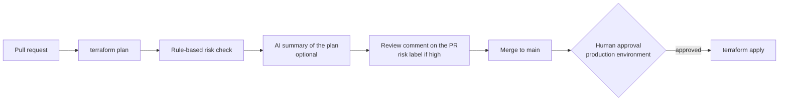

# AI-reviewed, human-approved Terraform

A small, working example of how I put AI into an infrastructure pipeline without
giving it the keys: the model helps the reviewer, rules set the risk, and a person
approves before anything is applied.



## Why it is built this way

- **Rules decide the risk, not the model.** Deletes, replacements and changes to
  access or data resources (IAM, security groups, KMS, databases) are always
  marked high risk. The result is the same whether the model is available or not.
- **The model only explains.** It gets resource addresses and actions, never
  attribute values, so secrets in the plan are not sent out. Its summary is
  labeled as generated and must be checked against the plan.
- **A person approves every apply.** The apply job runs in the `production`
  GitHub environment, which waits for a required reviewer.
- **The gate fails safe.** If the model times out, the review still posts with
  the rule-based result.

## What is in the repo

| Path | What it does |
|---|---|
| `terraform/main.tf` | A small configuration using the `local` and `random` providers, so the pipeline runs without cloud credentials. |
| `scripts/ai_review.py` | Reads `terraform show -json`, applies the risk rules, optionally asks a model for a summary, writes the PR comment. |
| `tests/` | Unit tests with sample plans (low, high, empty, many changes). |
| `.github/workflows/plan-review.yml` | On every PR: fmt, validate, plan, tests, review comment, `risk:high` label. |
| `.github/workflows/apply.yml` | On merge to `main`: waits for approval, then plans and applies. |

## Run it locally

```bash
cd terraform
terraform init && terraform plan -out=tfplan
terraform show -json tfplan > plan.json
cd ..
python scripts/ai_review.py terraform/plan.json --out review.md --no-llm
pytest -q tests
```

## Set it up on GitHub

1. **Settings > Environments > New environment** named `production`, then add
   yourself under **Required reviewers**.
2. Optional, for the AI summary: add the secrets `LLM_API_URL` (any
   OpenAI-compatible chat completions endpoint) and `LLM_API_KEY`, and the
   variable `LLM_MODEL`. Without them the review is rule-based only.
3. Open a pull request that changes `terraform/main.tf` and watch the review comment.

## Using it with a real cloud

Replace the providers in `main.tf` and give the workflows short-lived credentials
(for example OIDC to a cloud role). The review script reads the plan format, so it
does not change. Add your own sensitive resource types to `SENSITIVE_TYPES` in
`scripts/ai_review.py`.
